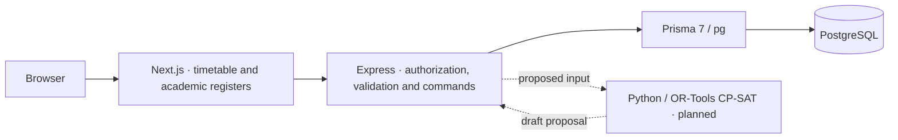
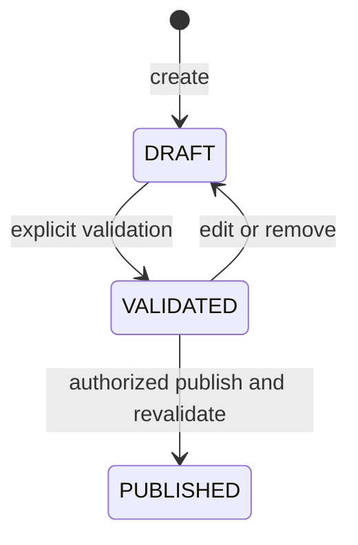

# Architecture

Next.js serves `/` from the imported timetable HTML/CSS, removes its legacy resource script, and pins the live browser script with CSP and SRI. `/overview`, `/setup`, `/faculty` and `/subjects` use the records layout. Server components read Express directly. Browser requests go through the allowlisted same-origin `/api/[...path]` proxy. The API alone owns the Prisma connection. The browser uses `sessionStorage` for operator credentials and reads old local storage only for export.

## Authentication and data flow

Express verifies configured bearer keys and sets an operator ID and publish flag. Academic register and published timetable reads are public to clients that can reach the app. Writes, operator identity and draft visibility require an operator. The proxy forwards credentials and avoids caching these responses. Both services bind to loopback in the current start scripts.

A timetable covers the academic year across semesters. A repeatable-read transaction combines catalog, version selection and display data. The working version uses current catalog labels. A published version uses a frozen display snapshot. Creating a draft copies placements from the most recent publication, or starts empty.

## Publication

Writes compare version ID and revision inside a serializable transaction. Publication assigns the next year-scoped version number and saves the publisher, timestamp and display snapshot atomically. Database triggers protect published versions and entries. A new draft is a separate version with new entry IDs.

## Scheduler boundary

Node will assemble a versioned snapshot, send it to Python, validate the reply against current state and persist accepted proposals as a draft. Python will neither own a database connection nor publish. Date-specific substitutions belong in the existing Node API. The [planned solver contract](TIMETABLE_ENGINE.md) and [decision log](DECISIONS.md) describe the boundary.
