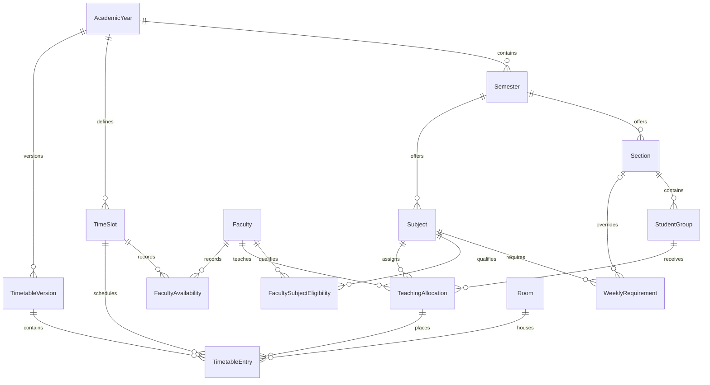

# Database schema

The schema is defined in [schema.prisma](../apps/api/prisma/schema.prisma). PostgreSQL migrations add constraints beyond Prisma's model declarations. Every model has a UUID primary key. No user, solver run, dated schedule, or substitution table exists.

| Model                       | Actual fields and constraints beyond the ID                                                                                                                                                                                                                                             |
| --------------------------- | --------------------------------------------------------------------------------------------------------------------------------------------------------------------------------------------------------------------------------------------------------------------------------------- |
| `AcademicYear`              | Unique `name`, ordered date-only `startsOn` and `endsOn`, `regularDailyClasses` default 3, nullable `maxTotalDailyPeriods` and `maxConsecutivePeriods`. A configured total is positive and at least the regular count. A configured consecutive limit is positive.                      |
| `Semester`                  | `academicYearId`, `number` from 1 to 6, unique per year                                                                                                                                                                                                                                 |
| `Section`                   | `semesterId`, `name` unique per semester. Composite key with semester for dependent references                                                                                                                                                                                          |
| `StudentGroup`              | `sectionId`, `semesterId`, unique `name` within section, nullable `wholeSection`. True means whole section, false means batch, null means unclassified.                                                                                                                                 |
| `Subject`                   | `semesterId`, `code` unique per semester, `name`. Composite key with semester for dependent references                                                                                                                                                                                  |
| `WeeklyRequirement`         | `subjectId`, `semesterId`, nullable `sectionId`, nonnegative `lectureCount`. Unique subject/section and a partial unique index for the null-section default                                                                                                                             |
| `Faculty`                   | Unique `facultyCode`, `name`, `active` default true. Identity spans semesters and years.                                                                                                                                                                                                |
| `FacultySubjectEligibility` | Unique pair `facultyId`, `subjectId`                                                                                                                                                                                                                                                    |
| `TeachingAllocation`        | `facultyId`, `subjectId`, `studentGroupId`, `semesterId`. Unique faculty/subject/group. Composite foreign keys keep the group and subject in the same semester.                                                                                                                         |
| `Room`                      | Unique `name`. No capacity, lab flag, or room availability table                                                                                                                                                                                                                        |
| `TimeSlot`                  | `academicYearId`, ISO `weekday` (1–7), minute interval `startsAtMinute`/`endsAtMinute`, `protectedBreak` default false. Unique year/day/start and a GiST exclusion constraint for overlaps within year/day                                                                              |
| `FacultyAvailability`       | Unique `facultyId`/`timeSlotId`, boolean `available`. An absent row means unrecorded.                                                                                                                                                                                                   |
| `TimetableVersion`          | `academicYearId`, `status` (DRAFT/VALIDATED/PUBLISHED), integer `revision` default 0. Nullable `number`, `publishedAt`, `publishedBy` (operator ID string), and JSON `snapshot` become required on publication. Unique year/number and one working version per year via a partial index |
| `TimetableEntry`            | Foreign keys `versionId`, `allocationId`, `timeSlotId` and `roomId`. Index on version/slot. Cross-year suitability and collision rules are enforced by the API.                                                                                                                         |

Foreign keys restrict deletion of referenced records. Composite references on section/group/subject relationships also restrict updates that would break semester consistency. The initial migration creates `btree_gist`, which supports the exclusion constraint. The second migration adds publication metadata constraints and triggers that reject changes to published versions and entries, including inserts into published versions.

Timetable reads use repeatable-read transactions. Timetable commands use serializable transactions. An edit updates the entries and revision together. Publication validates the catalog and placements before writing metadata and the snapshot within that same transaction. Academic CRUD uses individual Prisma operations. Changing configuration may invalidate an existing draft. Historical views read their stored snapshots.

Use `pnpm db:generate` after model changes and `pnpm db:migrate` to apply committed migrations. Keep applied SQL unchanged and check custom indexes, triggers, extensions and data effects when reviewing a migration. [Setup and migration workflow](SETUP_GUIDE.md)
